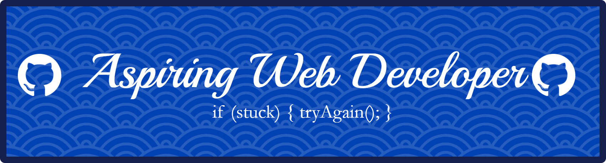

# Hi, saya Emilio 👋

Pelajar kelas 10 jurusan **Pengembangan Perangkat Lunak dan Gim (PPLG)**.
Saat ini saya sedang belajar **web development** dari dasar, dan GitHub ini adalah tempat saya mendokumentasikan perjalanan belajar saya.

## Yang sedang saya lakukan
- 📚 Belajar **HTML** dan **JavaScript**
- 🛠️ Membuat proyek kecil untuk melatih apa yang saya pelajari
- 🌱 Berikutnya: mempelajari **CSS** dan **Git/GitHub** lebih dalam
- 🤝 Terbuka untuk belajar bareng dan menerima masukan

<picture data-importer="pacman">
  <source media="(prefers-color-scheme: dark)" srcset="https://raw.githubusercontent.com/EmilioIXAshi/EmilioIXAshi/pacman-output/pacman-contribution-graph-dark.svg?game=pacman">
  <source media="(prefers-color-scheme: light)" srcset="https://raw.githubusercontent.com/EmilioIXAshi/EmilioIXAshi/pacman-output/pacman-contribution-graph.svg?game=pacman">
  
</picture>

###

## Tech stack

**Sedang dipelajari:** CSS

## Proyek

| Proyek | Deskripsi | Teknologi |
|--------|-----------|-----------|
| _Segera hadir_ | Proyek pertama saya sedang dikerjakan | HTML, JavaScript |

> Ide proyek berikutnya: kalkulator, to-do list, kuis sederhana, dan jam digital.

## Target belajar
- [x] Mulai belajar HTML
- [x] Mulai belajar JavaScript
- [x] Mulai belajar Python
- [ ] Menyelesaikan 3 proyek kecil
- [ ] Belajar CSS dan membuat halaman yang rapi
- [ ] Membuat portofolio sederhana
- [ ] Mencoba berkontribusi ke proyek open source

## Hubungi saya
- GitHub: [@EmilioIXAshi](https://github.com/EmilioIXAshi)
- Instagram: [@emilioixa](https://www.instagram.com/emilioixa/)

---
*Masih belajar, dan senang dengan saran atau masukan. Terima kasih sudah mampir! 🚀*
